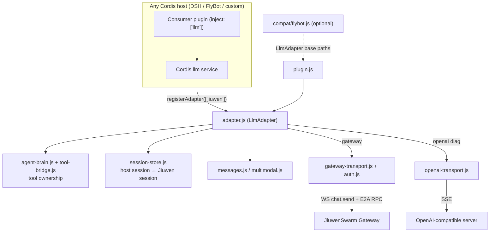
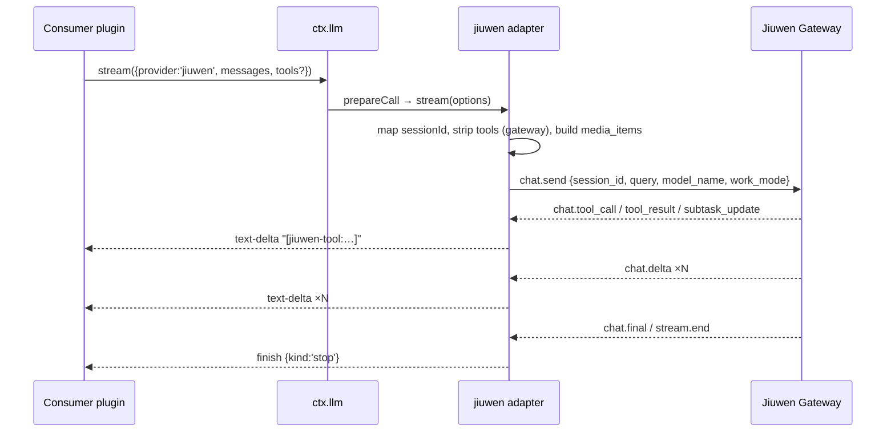

# Architecture: DSH Cordis ABI + JiuwenSwarm brain

## Non-negotiable split

| Concern | Owner | Notes |
|---------|--------|------|
| Cordis plugin load / host ABI | **Host** (DSH, FlyBot, any Cordis app) | Only the standard `llm` service is required |
| Chat / agent loop | **JiuwenSwarm** | Gateway `chat.send` runs the turn end-to-end |
| Tools / MCP / shell-as-agent | **JiuwenSwarm** | Adapter must **not** hand tool-calls back to DSH agent-loop |
| Memory | **JiuwenSwarm** | Lives in Jiuwen session; DSH only maps ids |
| Sessions | **JiuwenSwarm** (+ id map) | `$DSH_HOME/jiuwen-adapter/session-map.json` bridges DSH session/bot ↔ Jiuwen session/agent |
| Models | **JiuwenSwarm** | Catalog advertised on provider `jiuwen`; selection forwarded as `model_name` |
| History / files / MCP admin / swarm control | **JiuwenSwarm** | Exposed as unary E2A RPCs via `ctx.jiuwenAdapter.gateway.*` for ABI; UI cards stay optional |

DSH is **not** the agent brain. Using DSH `agent-loop` + a raw OpenAI LLM shim would put tools/memory/loop back on DSH — that path is a **diagnostics fallback only** (`mode=openai` / `allowDshAgentLoop`).

## Diagrams





## Product path (`mode=gateway`, default)

```
Any Cordis plugins/host  (DSH, FlyBot, custom; ABI, UI, channels)
        │  still talk to ctx.llm / sessions as usual
        ▼
 @dsh-jiuwen/adapter  (thin ABI adapter)
        │  map session id
        │  strip DSH tool schemas (brain owns tools)
        │  auth: query access_token + Bearer/X-Token/Cookie
        │  multimodal: image/file → media_items / attachments
        │  chat.send → stream deltas as text
        │  observe tool/media/subtask events as text markers
        │  unary E2A: history/models/mcp/memory/files/swarm
        ▼
 Jiuwen Gateway / AgentServer
        │  loop, tools, memory, swarm, models
        ▼
 final assistant text → DSH finish{stop}
```

Because the adapter returns `finish: stop` (never DSH `tool-call` blocks) in gateway mode, the local DSH agent-loop does not execute tools — Jiuwen already did.

## E2A surface (adapter)

Defined in `src/e2a-methods.js`, wired in `src/gateway-transport.js` + `src/plugin.js`:

- **Streaming:** `chat.send`, cancel/interrupt; inbound `chat.delta` / `chat.final` / tool / media / file / subtask / processing / todo events.
- **Unary RPCs:** `history.get`, `history.list_turns`, `session.get_metadata`, `models.list`, `mcp.list`, `memory.list`/`status`, `files.list`, `chat.interrupt`, `command.workflows`.
- **Tool ownership:** Gateway tool events are surfaced as text (`[jiuwen-tool:…]`) when `surfaceGatewayToolEvents` is on; they are **never** converted into DSH `tool-call` content blocks.

## Auth

`src/auth.js` mirrors Jiuwen web_proxy token order: query `access_token`/`token` → Bearer / `X-Token` → Cookie `access_token` → config/env. `buildGatewayWsUrl` appends `user_id` + `access_token`; Node also sends Authorization / X-Token / Cookie headers.

## Multimodal

`src/multimodal.js` projects DSH `image` / `file` content blocks into `chat.send` `media_items` / `files` attachments (data URL, base64, or path). Offloaded-only attachments become text markers — Gateway cannot read DSH's private attachment store.

## Fallback (`mode=openai`)

OpenAI-compatible `/v1/chat/completions` against a Jiuwen (or mock) front.

- Default: **do not** forward DSH tools (`allowDshAgentLoop=false`) so we do not silently rebuild a DSH-owned agent.
- Set `allowDshAgentLoop=true` only for harness debugging; that explicitly opts into DSH-as-brain (discouraged).

## Wrong direction (do not extend)

`openjiuwen/harness_providers/dsh` — Jiuwen hosts DSH as a CLI brain. This package is the inverse.

## Generic core vs. optional compat

- Core (`src/*.js`): depends only on the Cordis `llm` service (`registerAdapter`) and OpenAI-style messages/tools. `LlmAdapter` base from `@deepseek-ai/dsh-llm` if resolvable (or `llmAdapterModule`), else a duck-typed base.
- `src/compat/flybot.js`: FlyBot-only glue (monorepo paths for dsh-llm/cordis), loaded only when `compat` is `flybot`, or `auto` and a FlyBot checkout is detected. `compat: 'none'` disables it. No FlyBot session shapes, permission presets, or ds-bot interfaces are used by the core.
