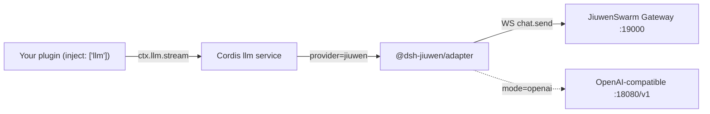

# @dsh-jiuwen/adapter

**Generic Cordis LLM provider: registers `jiuwen` on `ctx.llm` and routes it to JiuwenSwarm. The host (dsh or any Cordis app) is the plugin ABI/shell; JiuwenSwarm is the agent brain.**

中文（更详细）: [README.zh.md](./README.zh.md) · [ARCHITECTURE.md](./ARCHITECTURE.md) · [docs/configuration.md](./docs/configuration.md) · [docs/testing.md](./docs/testing.md) · [docs/troubleshooting.md](./docs/troubleshooting.md) · [VERIFICATION.md](./VERIFICATION.md)

## Quickstart

Full, verified walkthrough (Mac + Linux, prerequisites, model config, stop/restart, errors): **[docs/quickstart.md](./docs/quickstart.md)**.

```bash
# 1. JiuwenSwarm (Python 3.11–3.14)
uv venv ~/jiuwenswarm-venv --python 3.13 && source ~/jiuwenswarm-venv/bin/activate
uv pip install workswarm && jiuwenswarm-init
$EDITOR ~/.jiuwenswarm/config/.env        # API_BASE, API_KEY, MODEL_NAME, MODEL_PROVIDER=OpenAI, ENDPOINT_PROFILE
jiuwenswarm-start app                      # gateway → ws://127.0.0.1:19000/ws  (check: ss -ltn | grep 19000)

# 2. dsh (Node ≥ 22, dsh ≥ 0.2) — new terminal
npm install -g @deepseek-ai/dsh            # or: brew install dsh

# 3. this adapter
git clone https://github.com/Birfy/dsh-jiuwen-adapter.git && cd dsh-jiuwen-adapter
dsh plugin --profile web add "$PWD" && dsh plugin --profile headless add "$PWD"
for p in web headless; do printf -- '- id: agent-default-model\n  config:\n    provider: jiuwen\n    model: jiuwen-default\n' > ~/.dsh/profiles/$p/cordis.patch.yml; done

# 4. chat
dsh --profile headless "Say hello and end with QUICKSTART-OK"
dsh --profile web --no-open --port 3291    # open the printed http://127.0.0.1:3291/?token=… URL
```

## Overview

- The core depends only on the standard Cordis `llm` service (`ctx.llm.registerAdapter([id], adapter)`) and OpenAI-style messages/tools.
- `mode=gateway` (default): one `stream()` = one Gateway `chat.send`; loop, tools, memory, sessions and models run in JiuwenSwarm; text streams back.
- `mode=openai`: OpenAI-compatible diagnostics; with `allowDshAgentLoop` the host executes tools.



## Install (details)

```bash
# macOS: brew install dsh   (needs >= 0.2; 0.1.2-rc.1 lacks permissionPresets.catalog())
# Linux: Node >= 22, dsh via npm or source build
git clone git@github.com:Birfy/dsh-jiuwen-adapter.git
dsh plugin --profile web add $PWD/dsh-jiuwen-adapter
# non-DSH host: npm install /path/to/dsh-jiuwen-adapter, then ctx.plugin(...)
```

Gateway: `jiuwenswarm-start app` (listens on `ws://127.0.0.1:19000/ws`). Models: `~/.jiuwenswarm/config/.env` (`API_BASE`, `API_KEY`, `MODEL_NAME`, `MODEL_PROVIDER`, `ENDPOINT_PROFILE`, …; never commit). See [docs/configuration.md](./docs/configuration.md) for every option and default.

## Usage with any Cordis plugin

```js
import { Context } from '@deepseek-ai/cordis'
import LlmRuntime from '@deepseek-ai/dsh-llm'   // or any llm service with registerAdapter()
import * as jiuwen from '@dsh-jiuwen/adapter'

const ctx = new Context()
await ctx.plugin(LlmRuntime)
await ctx.plugin(jiuwen, { gatewayURL: 'ws://127.0.0.1:19000/ws' })

for await (const c of ctx.llm.stream({
  provider: 'jiuwen', model: 'jiuwen-default', sessionId: 'user-42',
  messages: [{ role: 'user', content: 'hello' }],
})) {
  if (c.type === 'text-delta') process.stdout.write(c.text)
  if (c.type === 'finish') console.log('\n', c.reason)
}
```

- **Tools**: gateway mode strips host `tools`; Jiuwen runs its own; activity appears in the reasoning block (`eventDisplay: markers` for legacy text markers), finish `stop`. `mode: 'openai', allowDshAgentLoop: true` forwards tools and returns `tool-call-delta` chunks, finish `tool-calls`.
- **Multimodal**: image/file parts (data URL or readable path) → `media_items`.
- **Sessions**: host `sessionId` → stable Jiuwen `session_id`, persisted at `mappingPath`.
- **E2A helpers**: `ctx.jiuwenAdapter.gateway.{historyGet, modelsList, mcpList, memoryList, filesList, chatCancel, workflows, sessionRename, sessionPin, goal, btw, recap, planStatus, skillsToggle, skillsInstalled, teamList, …}`.
- **Slash command**: `/jiuwen status|models|model|model-info|mode|pause|resume|rename|pin|fork|switch|archive|unarchive|unmap|delete|goal|workflows|history|btw|recap|skill-toggle|plan-status|supplement|teams|tools|hooks|permissions|plugins|projects|archived|assets|version|heartbeat|path|locale|commands|templates|cron|compact|interrupt|sessions|skills|agents|mcp|mcp-reset` (when the host has `ctx.commands`).

## Gateway features (primary mode)

Structured Jiuwen activity (reasoning, 🔧 tool calls, ✓ results, subtasks) streams as a standard `reasoning` block plus structured events (`ctx.jiuwenAdapter.onEvent`, `providerOptions.jiuwen.onEvent`, Cordis `jiuwen/event`); `usage` chunks; `processing_status` filtered; session continuity (only new user text after turn 1, host runtime-context stripped); abort → `chat.interrupt cancel`; agent/team/model/skills selection via config, catalog entries or `providerOptions.jiuwen`; images/files as `base64Data` (host `attachments` service supported); local session titles; extra RPCs (sessions, skills, agents, team templates, commands, interrupt, userAnswer, compact, generic `rpc`). Full list: [docs/gateway.md](./docs/gateway.md). Cooperation with other dsh plugins (user-questions, approval, opt-in dsh-tool passthrough via MCP, local compaction, `/jiuwen` slash command, typed `jiuwen/event`): [docs/dsh-integration.md](./docs/dsh-integration.md). dsh field report: [docs/bare-dsh.md](./docs/bare-dsh.md) (`npm run bare-dsh`).

## Testing

```bash
npm test && npm run smoke && npm run smoke:cordis && npm run smoke:live   # generic
```

## Troubleshooting

dsh 0.1.2-rc.1 `catalog()` error → upgrade dsh; 401 → `JIUWEN_ACCESS_TOKEN`/`JIUWEN_COOKIE`; `ECONNREFUSED :19000` → start gateway or `npm run mock:gateway`. More + FAQ: [docs/troubleshooting.md](./docs/troubleshooting.md).
