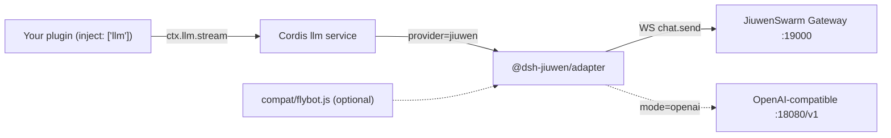

# @dsh-jiuwen/adapter

**Generic Cordis LLM provider: registers `jiuwen` on `ctx.llm` and routes it to JiuwenSwarm. The host (DSH, FlyBot, or any Cordis app) is the plugin ABI/shell; JiuwenSwarm is the agent brain.**

中文（更详细）: [README.zh.md](./README.zh.md) · [ARCHITECTURE.md](./ARCHITECTURE.md) · [docs/configuration.md](./docs/configuration.md) · [docs/testing.md](./docs/testing.md) · [docs/troubleshooting.md](./docs/troubleshooting.md) · [VERIFICATION.md](./VERIFICATION.md)

## Overview

- The core depends only on the standard Cordis `llm` service (`ctx.llm.registerAdapter([id], adapter)`) and OpenAI-style messages/tools. No FlyBot, ds-bot or permissionPresets dependency.
- `mode=gateway` (default): one `stream()` = one Gateway `chat.send`; loop, tools, memory, sessions and models run in JiuwenSwarm; text streams back.
- `mode=openai`: OpenAI-compatible diagnostics; with `allowDshAgentLoop` the host executes tools.
- FlyBot-specific glue is isolated in the optional `src/compat/flybot.js`.



## Install

```bash
# macOS: brew install dsh   (needs >= 0.2; 0.1.2-rc.1 lacks permissionPresets.catalog())
# Linux: Node >= 22, dsh via npm or source build
git clone git@github.com:Birfy/dsh-jiuwen-adapter.git
dsh plugin --profile web add $PWD/dsh-jiuwen-adapter
# non-DSH host: npm install /path/to/dsh-jiuwen-adapter, then ctx.plugin(...)
```

Gateway: `jiuwenswarm-start app` (listens on `ws://127.0.0.1:19000/ws`). Models: `~/.jiuwenswarm/config/.env` (`API_BASE`, `API_KEY`, `MODEL_NAME`, `MODEL_PROVIDER`, `ENDPOINT_PROFILE`, …; never commit). See [docs/configuration.md](./docs/configuration.md) for every option and default.

## Usage with any Cordis plugin

```js
import { Context } from '@deepseek-ai/cordis'
import LlmRuntime from '@deepseek-ai/dsh-llm'   // or any llm service with registerAdapter()
import * as jiuwen from '@dsh-jiuwen/adapter'

const ctx = new Context()
await ctx.plugin(LlmRuntime)
await ctx.plugin(jiuwen, { compat: 'none', gatewayURL: 'ws://127.0.0.1:19000/ws' })

for await (const c of ctx.llm.stream({
  provider: 'jiuwen', model: 'jiuwen-default', sessionId: 'user-42',
  messages: [{ role: 'user', content: 'hello' }],
})) {
  if (c.type === 'text-delta') process.stdout.write(c.text)
  if (c.type === 'finish') console.log('\n', c.reason)
}
```

- **Tools**: gateway mode strips host `tools`; Jiuwen runs its own and you see `[jiuwen-tool:name]` markers, finish `stop`. `mode: 'openai', allowDshAgentLoop: true` forwards tools and returns `tool-call-delta` chunks, finish `tool-calls`.
- **Multimodal**: image/file parts (data URL or readable path) → `media_items`.
- **Sessions**: host `sessionId` → stable Jiuwen `session_id`, persisted at `mappingPath`.
- **E2A helpers**: `ctx.jiuwenAdapter.gateway.{historyGet, modelsList, mcpList, memoryList, filesList, chatCancel, workflows}`.

## Optional FlyBot compat

`compat: auto` (default) enables `src/compat/flybot.js` only if a FlyBot checkout is found (`$FLYBOT_ROOT`, default `/workspace/FlyBot`); `flybot` forces, `none` disables. The existing `cordis.patch.yml` (`llm-jiuwen`, `jiuwen-default`) is unchanged.

## Testing

```bash
npm test && npm run smoke && npm run smoke:cordis && npm run smoke:live   # generic
npm run verify:flybot                                                     # optional FlyBot compat
```

## Troubleshooting

dsh 0.1.2-rc.1 `catalog()` error → upgrade dsh; 401 → `JIUWEN_ACCESS_TOKEN`/`JIUWEN_COOKIE`; `ECONNREFUSED :19000` → start gateway or `npm run mock:gateway`. More + FAQ: [docs/troubleshooting.md](./docs/troubleshooting.md).
