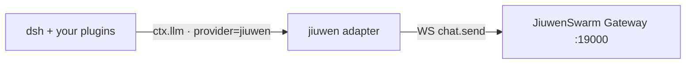

<p align="center"></p>

<h1 align="center">dsh-jiuwen-adapter</h1>

<p align="center"><b>Use JiuwenSwarm as the brain of dsh, with your other dsh plugins still working.</b></p>

<p align="center">
  <a href="https://github.com/Birfy/dsh-jiuwen-adapter/actions/workflows/ci.yml"></a>
  
  
  <a href="./LICENSE"></a>
</p>

<p align="center"><a href="./README.zh.md">中文</a> · <a href="./docs/quickstart.md">Quickstart</a> · <a href="./docs/configuration.md">Config</a> · <a href="./docs/dsh-integration.md">dsh integration</a> · <a href="./CHANGELOG.md">Changelog</a></p>

---

A Cordis plugin that registers a `jiuwen` provider on `ctx.llm`. dsh still handles the UI, sessions, approvals and plugins. Each turn goes to the [JiuwenSwarm](https://pypi.org/project/workswarm/) Gateway, which runs its own agents, tools and memory.



## 30-second quickstart

```bash
# 1. Brain: start JiuwenSwarm (put your model key in ~/.jiuwenswarm/config/.env)
uv pip install workswarm && jiuwenswarm-init && jiuwenswarm-start app

# 2. Plugin: install into a dsh profile (dsh >= 0.2.1-rc.2: npm i -g @deepseek-ai/dsh@next)
dsh plugin --profile web add "git+https://github.com/Birfy/dsh-jiuwen-adapter.git"

# 3. Make it the default model, then chat
printf -- '- id: agent-default-model\n  config:\n    provider: jiuwen\n    model: jiuwen-default\n' >> ~/.dsh/profiles/web/cordis.patch.yml
dsh --profile web
```

Step-by-step guide for Mac and Linux: **[docs/quickstart.md](./docs/quickstart.md)**. To try it without a Gateway, run `npm run mock:gateway`.

## Features

| | What you get | Default |
|---|---|---|
| 🧠 **Jiuwen brain** | One dsh turn is one Gateway `chat.send`. Agents, team mode, skills and memory run in Jiuwen | on |
| 💬 **Live activity** | Reasoning, 🔧 tool calls, subtasks and token usage stream into dsh | on |
| ✅ **dsh approvals and questions** | Jiuwen permission prompts, plan approval and `ask_user` go through dsh's own dialogs, and deny when no answer comes | on |
| 🔁 **Session continuity** | dsh sessions map to Jiuwen sessions. Only new text is sent after the first turn | on |
| 🛟 **Drop recovery** | If the Gateway drops mid-answer, the reply is recovered from history and marked as recovered | on |
| 🧾 **Local titles and compaction** | Titles and `/compact` are handled locally, so they never cost a Jiuwen turn | on |
| ⌨️ **`/jiuwen` command** | Sessions, models, modes, skills, agents, cron, MCP and more ([list](./docs/dsh-integration.md#5-jiuwen-slash-command-dsh-command-registry)) | on |
| 🖼️ **Multimodal** | Image and file parts are sent as Jiuwen media | on |
| 🪪 **System prompt → Jiuwen** | `injectSystem: persona\|full` sends the host persona (or whole system prompt) once per Jiuwen session, resent only on change | opt-in |
| 🪜 **Full trajectory** | `trajectoryDetail: full` renders Jiuwen tool calls, results, subtasks and plan steps as Markdown steps in the reasoning block | opt-in |
| 🔌 **dsh tools → Jiuwen** | Allowlisted dsh tools exposed to Jiuwen over MCP, each call gated by an approval | opt-in |
| 🧭 **Bridges** | Model discovery, session sync, plan bridge, typed events | opt-in |
| 🩺 **Config validation** | Unknown keys get a "did you mean" hint and deprecated keys get a warning. Never throws | on |

## Compatibility

Other dsh plugins must keep working. The adapter is tested against the **full dsh agent runtime** (`dsh-agent`, `dsh-agent-loop`, compaction, subagents, goals, plan mode, a bash sandbox, approvals and user-questions). The same scripted session runs once with jiuwen loaded and once without. Every row of the [compat matrix](./docs/known-issues.md#15-round-8-full-runtime-scenarios--version-matrix) must match, covering events, tool calls, plan exit, goal rounds, auto-compaction, subagents, bash, host event counts, globals and load failures.

| Component | Supported | Tested in CI |
|---|---|---|
| dsh | `>=0.2.1-rc.2 <0.3.0` | 0.2.1-rc.2, 0.2.1-rc.5 |
| Cordis | `^4.0.5` | 4.0.5 |
| Node | `>=22` | 22, 24 |
| JiuwenSwarm | 0.2.x Gateway | 0.2.7 (live) |

The adapter also works in any Cordis app that has an `llm` service ([usage](./docs/usage.md)).

## Docs

- [Quickstart](./docs/quickstart.md), [Configuration](./docs/configuration.md), [Troubleshooting](./docs/troubleshooting.md)
- [Using it from code and Gateway features](./docs/usage.md), [Gateway RPC coverage](./docs/coverage.md)
- [dsh integration](./docs/dsh-integration.md), [Testing](./docs/testing.md), [Known issues and test logs](./docs/known-issues.md)
- [Publishing to a dsh plugin market](./docs/marketplace.md), [Architecture](./ARCHITECTURE.md)

## Development

```bash
npm test                      # unit, mock-gateway and runtime suites
npm run compat -- --diff      # with vs. without jiuwen compat matrix (needs DSH_NM=<dsh node_modules>)
npm run market:index          # regenerate market/index.json
```

Licensed under [Apache-2.0](./LICENSE).
