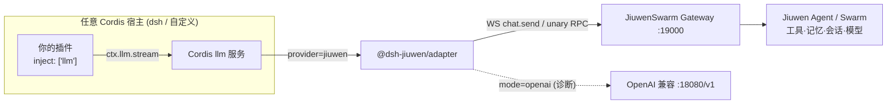

# @dsh-jiuwen/adapter

**通用 Cordis LLM provider：把 `ctx.llm` 上的 `jiuwen` provider 路由到 JiuwenSwarm。宿主（dsh 或任意 Cordis 应用）= 插件 ABI/壳；JiuwenSwarm = Agent 脑。**

English: [README.md](./README.md) · 架构：[ARCHITECTURE.md](./ARCHITECTURE.md) · 配置：[docs/configuration.md](./docs/configuration.md) · 测试：[docs/testing.md](./docs/testing.md) · 排障/FAQ：[docs/troubleshooting.md](./docs/troubleshooting.md) · 验证记录：[VERIFICATION.md](./VERIFICATION.md)

## 🚀 Quickstart（快速开始）

完整、逐条实测过的步骤（Mac + Linux、前置依赖、模型配置、停止/重启、常见错误）见 **[docs/quickstart.md](./docs/quickstart.md)**。最短路径：

```bash
# 1. 安装并启动 JiuwenSwarm（Python 3.11–3.14）
uv venv ~/jiuwenswarm-venv --python 3.13 && source ~/jiuwenswarm-venv/bin/activate
uv pip install workswarm && jiuwenswarm-init
$EDITOR ~/.jiuwenswarm/config/.env        # 填 API_BASE / API_KEY / MODEL_NAME / MODEL_PROVIDER=OpenAI / ENDPOINT_PROFILE
jiuwenswarm-start app                      # Gateway：ws://127.0.0.1:19000/ws（检查：ss -ltn | grep 19000）

# 2. 安装 dsh（Node ≥ 22，dsh ≥ 0.2）——另开终端
npm install -g @deepseek-ai/dsh            # 或 macOS：brew install dsh

# 3. 安装本适配器
git clone https://github.com/Birfy/dsh-jiuwen-adapter.git && cd dsh-jiuwen-adapter
dsh plugin --profile web add "$PWD" && dsh plugin --profile headless add "$PWD"
for p in web headless; do printf -- '- id: agent-default-model\n  config:\n    provider: jiuwen\n    model: jiuwen-default\n' > ~/.dsh/profiles/$p/cordis.patch.yml; done

# 4. 开聊
dsh --profile headless "用一句话介绍你自己，并以 QUICKSTART-OK 结尾"
dsh --profile web --no-open --port 3291    # 浏览器打开打印出的 http://127.0.0.1:3291/?token=… 地址
```

停止：dsh / JiuwenSwarm 所在终端 Ctrl-C；重启：重新执行对应命令。连不上 Gateway 时 dsh 报 `TRANSPORT: Jiuwen Gateway WebSocket failed`，先确认 19000 端口在监听。

## 1. 概览

- 核心只依赖**标准 Cordis `llm` 服务**（`ctx.llm.registerAdapter([id], adapter)`）和 **OpenAI 风格**的 messages / tools。
- 默认 `mode=gateway`：一次 `stream()` = 一次 Gateway `chat.send`，聊天循环、工具、记忆、会话、模型全部在 JiuwenSwarm 执行，增量文本流式回传。
- `mode=openai`：OpenAI 兼容接口，仅用于诊断；配合 `allowDshAgentLoop` 可让宿主自己执行工具。

## 2. 架构



## 3. 安装

### Mac（Homebrew dsh）

```bash
brew install dsh            # 需 >= 0.2；0.1.2-rc.1 缺 permissionPresets.catalog()
git clone git@github.com:Birfy/dsh-jiuwen-adapter.git
dsh plugin --profile web add $PWD/dsh-jiuwen-adapter
```

### Linux

```bash
# Node >= 22；dsh 用 npm 全局安装或源码构建
git clone git@github.com:Birfy/dsh-jiuwen-adapter.git
dsh plugin --profile web add $PWD/dsh-jiuwen-adapter
# 非 DSH 宿主：npm install /path/to/dsh-jiuwen-adapter 后 ctx.plugin() 加载
```

本包无运行时依赖；`@deepseek-ai/cordis`、`@deepseek-ai/dsh-llm` 为可选 peer。

## 4. JiuwenSwarm Gateway 与模型配置

1. 启动：`jiuwenswarm-start app`（WS 监听 `ws://127.0.0.1:19000/ws`）。检查：`ss -ltn | grep 19000`。
2. 模型：编辑 `~/.jiuwenswarm/config/.env`（**切勿提交**）：
   - `API_BASE`、`API_KEY`、`MODEL_NAME`
   - `MODEL_PROVIDER`：协议名 `OpenAI` 或 `Anthropic`
   - `ENDPOINT_PROFILE`：`openai`/`deepseek`/`openrouter`/`siliconflow`/`dashscope`/`openai_compatible`/`ollama`/`lmstudio`/`vllm`/`sglang`
   - 可选：`CUSTOM_HEADERS`、`EMBED_API_BASE/KEY/MODEL`、`VIDEO_API_BASE/KEY/MODEL_NAME/PROVIDER`
   - 其他设置在 `~/.jiuwenswarm/config/config.yaml`。修改后重启 gateway。
3. 若 gateway 需要鉴权，设置 `JIUWEN_ACCESS_TOKEN` 或 `JIUWEN_COOKIE`。

## 5. 配置（摘要，完整表见 docs/configuration.md）

| 键 | 环境变量 | 默认 |
|---|---|---|
| `mode` | `JIUWEN_MODE` | `gateway` |
| `gatewayURL` | `JIUWEN_GATEWAY_URL` | `ws://127.0.0.1:19000/ws` |
| `baseURL` | `JIUWEN_BASE_URL` | `http://127.0.0.1:18080/v1` |
| `apiKey`/`authToken`/`accessToken`/`cookie`/`authorization`/`xToken` | `JIUWEN_API_KEY`/`_AUTH_TOKEN`/`_ACCESS_TOKEN`/`_COOKIE`/`_AUTHORIZATION`/`_X_TOKEN` | 空 |
| `userId` | `JIUWEN_USER_ID` | `dsh-adapter` |
| `mappingPath` | `JIUWEN_SESSION_MAP` | `$DSH_HOME/jiuwen-adapter/session-map.json` |
| `workMode` / `projectDir` | `JIUWEN_WORK_MODE` / `JIUWEN_PROJECT_DIR` | `agent` / 空 |
| `requestTimeoutMs` | `JIUWEN_TIMEOUT_MS` | `180000` |
| `allowDshAgentLoop` | `JIUWEN_ALLOW_DSH_AGENT_LOOP=1` | `false` |
| `exposeJiuwenTools` | `JIUWEN_EXPOSE_TOOLS=1` | `false` |
| `surfaceGatewayToolEvents` | — | `true` |
| `llmAdapterModule` | `JIUWEN_LLM_ADAPTER_MODULE` | 空 |
| `provider`/`displayName`/`models`/`defaultModel` | — | `jiuwen`/`JiuwenSwarm`/两个默认模型/首个 |

环境变量优先于插件配置。

## 6. 在任意 Cordis 插件中使用

### 加载

```js
import { Context } from '@deepseek-ai/cordis'
import LlmRuntime from '@deepseek-ai/dsh-llm'
import * as jiuwen from '@dsh-jiuwen/adapter'

const ctx = new Context()
await ctx.plugin(LlmRuntime)                 // 或你自己的 llm 服务（需 registerAdapter）
await ctx.plugin(jiuwen, { gatewayURL: 'ws://127.0.0.1:19000/ws' })
```

### 普通对话 + 流式

```js
export const name = 'my-plugin'
export const inject = ['llm']
export function apply(ctx) {
  ctx.command?.('ask <q>').action(async (_, q) => {
    let out = ''
    for await (const c of ctx.llm.stream({
      provider: 'jiuwen', model: 'jiuwen-default', sessionId: 'user-42',
      messages: [{ role: 'system', content: '简洁回答' }, { role: 'user', content: q }],
    })) {
      if (c.type === 'text-delta') out += c.text      // 增量
      if (c.type === 'finish') console.log(c.reason)  // { kind: 'stop' | 'tool-calls' | 'error' ... }
    }
    return out
  })
}
```

### 工具调用

```js
const tools = [{ name: 'get_weather', description: '查天气',
  parameters: { type: 'object', properties: { city: { type: 'string' } } } }]
// gateway 模式：tools 被剥离，Jiuwen 用自己的工具；你会看到 "[jiuwen-tool:shell]" 文本 marker，finish=stop
// openai + allowDshAgentLoop：tools 转为 OpenAI tools；返回 tool-call-delta / block-end，finish=tool-calls
for await (const c of ctx.llm.stream({ provider: 'jiuwen', model: 'jiuwen-default', messages, tools })) {
  if (c.type === 'tool-call-delta') console.log(c.name, c.argumentsDelta)
}
```

### E2A 辅助 RPC

```js
const jw = ctx.jiuwenAdapter           // 通过 ctx.provide('jiuwenAdapter') 暴露
await jw.gateway.modelsList()
await jw.gateway.historyGet(sessionId)
await jw.gateway.mcpList('builtin')
await jw.gateway.chatCancel(sessionId)
```

## 7. 行为说明

- **流式**：`chat.delta` → `text-delta`，`chat.reasoning` → `reasoning-delta`；`chat.processing_status.is_complete` / `stream.end` / `chat.final`+宽限 → `finish`；`chat.error` → `finish {kind: error, code: JIUWEN_ERROR}`（不可重试）；取消 → `aborted`。
- **工具**：gateway 模式下工具归 Jiuwen；`chat.tool_call`/`chat.tool_result`/`chat.subtask_update` 默认进入 `reasoning` 块（`eventDisplay: markers` 为旧文本 marker，`none` 隐藏），并作为结构化事件发出，不会让宿主二次执行。
- **多模态**：消息中 image/file（data URL 或可读路径）→ `media_items` / `attachments`；不可读附件只发文本占位。
- **会话**：宿主 `sessionId` → 稳定 Jiuwen `session_id`（`dsh-<hex>`，记录轮数），持久化到 `mappingPath`；第二轮起只发新消息；历史与记忆在 Jiuwen。未传 sessionId 时归为 `anonymous`。
- **模型**：`model` 作为 `model_name` 转发；`listModels` 返回配置中的目录。

## 8.5 Gateway 进阶能力（主力模式）

完整能力清单见 [docs/gateway.md](./docs/gateway.md)。要点：

- **结构化事件**：Jiuwen 推理、工具调用（🔧 名称+参数）、工具结果（✓/✗）、子任务/团队活动进入标准 `reasoning` 块；文本只含最终回答。`ctx.jiuwenAdapter.onEvent(fn)` / `providerOptions.jiuwen.onEvent` / Cordis 事件 `jiuwen/event` 拿到结构化事件（`tool_call`、`tool_result`、`usage`、`ask_user`…）。`eventDisplay: markers` 恢复旧文本 marker。
- **usage**：`chat.usage_summary` → 标准 `usage` chunk。
- **processing_status 不再泄漏**（`showProcessingStatus` 可开）。
- **会话连续性**：第二轮起只发新用户消息，Jiuwen 保有历史/记忆；宿主 runtime context 块自动剔除。
- **取消**：宿主 abort → `chat.interrupt {intent: cancel}`。
- **选择 agent/team/model/skills**：配置 `chatMode / agentTemplateName / agentGroupName / skills`，目录模型条目 `modelName / chatMode`（`jiuwen-swarm` = `team.work.normal`），或每次请求 `providerOptions.jiuwen.{chatMode, agentTemplateName, agentGroupName, skills, modelName, projectDir, sessionId}`。
- **附件**：图片/文件以 `base64Data` 发送；宿主有 `attachments` 服务（DSH）时自动解析内容寻址附件。
- **辅助调用**：`session-title` 本地即时生成，`compaction` 用一次性 Jiuwen 会话。
- **更多 RPC**：`gateway.sessionList/sessionFork/sessionRename/sessionPin/skillsList/skillsToggle/agentsList/teamTemplatesList/commandsList/interrupt/userAnswer/compact/goal/workflows/rpc(...)`。

```js
for await (const c of ctx.llm.stream({ provider: 'jiuwen', model: 'jiuwen-swarm', sessionId: 'u1',
  messages: [{ role: 'user', content: '帮我调研三家竞品并写总结' }],
  providerOptions: { jiuwen: { skills: ['pptx-generator'], onEvent: e => e.type === 'tool_call' && console.log('tool', e.name) } },
})) { if (c.type === 'reasoning-delta') process.stderr.write(c.text); if (c.type === 'text-delta') process.stdout.write(c.text) }
```

## 8.6 dsh 实测

`BARE=$HOME/bare-dsh npm run bare-dsh` 一键安装 npm 版 dsh 并配置 headless/web profile；之后 `dsh --profile headless "…"` 或 `dsh --profile web --no-open --port 3291`。实测记录与 UX 观察见 [docs/bare-dsh.md](./docs/bare-dsh.md)。

## 9. 测试

```bash
npm test              # 单元 + 通用宿主（mock gateway）
npm run smoke         # mock openai + gateway
npm run smoke:cordis  # 真实 Cordis Context 加载
npm run smoke:live    # 真实 gateway :19000（13 项），不在线则 SKIP
npm run bare-dsh      # 裸 dsh 安装/配置
```
详见 [docs/testing.md](./docs/testing.md)。

## 10. 排障

- **dsh 0.1.2-rc.1 `catalog()` 报错**：升级 dsh >= 0.2。
- **401 / cookie 失效**：重设 `JIUWEN_ACCESS_TOKEN` / `JIUWEN_COOKIE`，核对 `JIUWEN_USER_ID`。
- **gateway 未监听**：`jiuwenswarm-start app`，或先用 `npm run mock:gateway`。
- **「还没有配置可用的模型」**：填 `.env` 后重启。
更多与 FAQ 见 [docs/troubleshooting.md](./docs/troubleshooting.md)。

## 11. 源码结构

| 模块 | 作用 |
|---|---|
| `src/plugin.js` | Cordis 入口：注册 provider、`ctx.jiuwenAdapter`、LlmAdapter 基类解析 |
| `src/adapter.js` | LlmAdapter 实现（listModels / resolveModel / prepareCall / stream） |
| `src/config.js` / `src/schema.js` | 配置解析 / Standard Schema |
| `src/gateway-transport.js` | WS `chat.send` 流 + unary RPC |
| `src/openai-transport.js` | OpenAI 兼容 SSE（诊断） |
| `src/agent-brain.js` / `src/tool-bridge.js` | 工具所有权策略 |
| `src/messages.js` / `src/multimodal.js` | 消息转换 / 媒体 |
| `src/auth.js` | 鉴权材料与 WS URL |
| `src/session-store.js` | 会话映射 |
| `src/stream-emit.js` | StreamChunk 生成 |
| `src/e2a-methods.js` | E2A 方法/事件表 |

## 当前缺口（诚实）

1. **Live chat 需真实模型**：本机 `:19000` 已通过 `npm run smoke:live` 13/13（2026-10-29）；未配置模型时 `chat.send` 返回「还没有配置可用的模型…」。图片需要 Jiuwen 侧视觉模型。
2. **dsh web UI** 已用 npm 版 dsh 0.2.1-rc.2 实测可用（见 docs/bare-dsh.md）。
3. DSH 附件若仅 device/offloaded、无 data URL / 可读 path，只能发文本占位；Gateway 无法拉取 DSH 私有 attachment store。
4. dsh 工具默认不交给 Jiuwen；可选 `toolPassthrough: mcp` + `toolAllowlist` 把 dsh（含其他插件/MCP）工具以本地 MCP 暴露给 Jiuwen（dsh 执行 + dsh 审批）。Jiuwen 工具/子任务以推理块文本 + 结构化事件呈现；宿主 UI 不会把它们画成原生工具卡片（标准 llm 流语法里工具块意味着宿主执行）。
6. `ask_user`：默认 `supportsUserInteraction: auto`，宿主有 `ctx.userQuestions` 时走 dsh 原生问答卡并自动回传（`chat.send` resume / `chat.user_answer`）；无答题 UI 时回中性答复。Jiuwen 工具权限 / 计划审批走 dsh `ctx.approval`，默认拒绝（无 UI/超时）。见 [docs/dsh-integration.md](./docs/dsh-integration.md)。
7. dsh 的标题/压缩辅助调用默认本地处理（`titleMode`/`compactionMode: local`），不消耗 Jiuwen 回合。
8. dsh 命令：`/jiuwen status|models|model|model-info|mode|pause|resume|rename|pin|fork|switch|archive|unarchive|unmap|delete confirm|goal|workflows|history|btw|recap|skill-toggle|plan-status|supplement|teams|tools|hooks|permissions|plugins|projects|archived|assets|version|heartbeat|path|locale|commands|templates|cron|compact|interrupt|sessions|skills|agents|mcp|mcp-reset confirm`（宿主有 `ctx.commands` 时注册；会话级 mode/skills/agentTemplate 可覆盖默认配置）。
9. 结构化事件 `jiuwen/event` 已在 `index.d.ts` 声明类型，字段见 docs/dsh-integration.md §6。
5. Jiuwen 前端 `channels/web/frontend/dist` 未构建；仅后端/WS 路径已验证。

> 更新（2026-10-30）：`/jiuwen` 新增 config / memory / cron·heartbeat 读写 / permissions rule / team / template / group / git / continue-queued / swarm-stop / doc / media 子命令（删除需 `confirm`）；网关方法自动探测（unknown method 缓存并在 help 中隐藏）；可选桥接 `modelDiscovery`、`sessionSync`、`planBridge`、`typedEvents`、`documentPersist` 默认全部关闭。覆盖率见 docs/coverage.md（104/334）。
