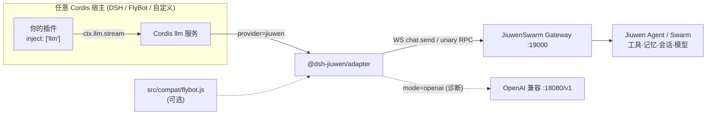

# @dsh-jiuwen/adapter

**通用 Cordis LLM provider：把 `ctx.llm` 上的 `jiuwen` provider 路由到 JiuwenSwarm。宿主（DSH、FlyBot 或任意 Cordis 应用）= 插件 ABI/壳；JiuwenSwarm = Agent 脑。**

English: [README.md](./README.md) · 架构：[ARCHITECTURE.md](./ARCHITECTURE.md) · 配置：[docs/configuration.md](./docs/configuration.md) · 测试：[docs/testing.md](./docs/testing.md) · 排障/FAQ：[docs/troubleshooting.md](./docs/troubleshooting.md) · 验证记录：[VERIFICATION.md](./VERIFICATION.md)

## 1. 概览

- 核心只依赖**标准 Cordis `llm` 服务**（`ctx.llm.registerAdapter([id], adapter)`）和 **OpenAI 风格**的 messages / tools，不依赖 FlyBot、ds-bot、permissionPresets。
- 默认 `mode=gateway`：一次 `stream()` = 一次 Gateway `chat.send`，聊天循环、工具、记忆、会话、模型全部在 JiuwenSwarm 执行，增量文本流式回传。
- `mode=openai`：OpenAI 兼容接口，仅用于诊断；配合 `allowDshAgentLoop` 可让宿主自己执行工具。
- FlyBot 专用逻辑隔离在可选模块 `src/compat/flybot.js`。

## 2. 架构



## 3. 安装

### Mac（Homebrew dsh）

```bash
brew install dsh            # 需 >= 0.2；0.1.2-rc.1 缺 permissionPresets.catalog()
git clone git@github.com:Birfy/dsh-jiuwen-adapter.git
dsh plugin --profile web add $PWD/dsh-jiuwen-adapter
```

### Linux

```bash
# Node >= 22；dsh 用 npm 全局安装或源码构建
git clone git@github.com:Birfy/dsh-jiuwen-adapter.git
dsh plugin --profile web add $PWD/dsh-jiuwen-adapter
# 非 DSH 宿主：npm install /path/to/dsh-jiuwen-adapter 后 ctx.plugin() 加载
```

本包无运行时依赖；`@deepseek-ai/cordis`、`@deepseek-ai/dsh-llm` 为可选 peer。

## 4. JiuwenSwarm Gateway 与模型配置

1. 启动：`jiuwenswarm-start app`（WS 监听 `ws://127.0.0.1:19000/ws`）。检查：`ss -ltn | grep 19000`。
2. 模型：编辑 `~/.jiuwenswarm/config/.env`（**切勿提交**）：
   - `API_BASE`、`API_KEY`、`MODEL_NAME`
   - `MODEL_PROVIDER`：协议名 `OpenAI` 或 `Anthropic`
   - `ENDPOINT_PROFILE`：`openai`/`deepseek`/`openrouter`/`siliconflow`/`dashscope`/`openai_compatible`/`ollama`/`lmstudio`/`vllm`/`sglang`
   - 可选：`CUSTOM_HEADERS`、`EMBED_API_BASE/KEY/MODEL`、`VIDEO_API_BASE/KEY/MODEL_NAME/PROVIDER`
   - 其他设置在 `~/.jiuwenswarm/config/config.yaml`。修改后重启 gateway。
3. 若 gateway 需要鉴权，设置 `JIUWEN_ACCESS_TOKEN` 或 `JIUWEN_COOKIE`。

## 5. 配置（摘要，完整表见 docs/configuration.md）

| 键 | 环境变量 | 默认 |
|---|---|---|
| `mode` | `JIUWEN_MODE` | `gateway` |
| `gatewayURL` | `JIUWEN_GATEWAY_URL` | `ws://127.0.0.1:19000/ws` |
| `baseURL` | `JIUWEN_BASE_URL` | `http://127.0.0.1:18080/v1` |
| `apiKey`/`authToken`/`accessToken`/`cookie`/`authorization`/`xToken` | `JIUWEN_API_KEY`/`_AUTH_TOKEN`/`_ACCESS_TOKEN`/`_COOKIE`/`_AUTHORIZATION`/`_X_TOKEN` | 空 |
| `userId` | `JIUWEN_USER_ID` | `dsh-adapter` |
| `mappingPath` | `JIUWEN_SESSION_MAP` | `$DSH_HOME/jiuwen-adapter/session-map.json` |
| `workMode` / `projectDir` | `JIUWEN_WORK_MODE` / `JIUWEN_PROJECT_DIR` | `agent` / 空 |
| `requestTimeoutMs` | `JIUWEN_TIMEOUT_MS` | `180000` |
| `allowDshAgentLoop` | `JIUWEN_ALLOW_DSH_AGENT_LOOP=1` | `false` |
| `exposeJiuwenTools` | `JIUWEN_EXPOSE_TOOLS=1` | `false` |
| `surfaceGatewayToolEvents` | — | `true` |
| `compat` | `JIUWEN_COMPAT` | `auto`（`flybot`/`none`） |
| `llmAdapterModule` | `JIUWEN_LLM_ADAPTER_MODULE` | 空 |
| `provider`/`displayName`/`models`/`defaultModel` | — | `jiuwen`/`JiuwenSwarm`/两个默认模型/首个 |

环境变量优先于插件配置。

## 6. 在任意 Cordis 插件中使用

### 加载

```js
import { Context } from '@deepseek-ai/cordis'
import LlmRuntime from '@deepseek-ai/dsh-llm'
import * as jiuwen from '@dsh-jiuwen/adapter'

const ctx = new Context()
await ctx.plugin(LlmRuntime)                 // 或你自己的 llm 服务（需 registerAdapter）
await ctx.plugin(jiuwen, { compat: 'none', gatewayURL: 'ws://127.0.0.1:19000/ws' })
```

### 普通对话 + 流式

```js
export const name = 'my-plugin'
export const inject = ['llm']
export function apply(ctx) {
  ctx.command?.('ask <q>').action(async (_, q) => {
    let out = ''
    for await (const c of ctx.llm.stream({
      provider: 'jiuwen', model: 'jiuwen-default', sessionId: 'user-42',
      messages: [{ role: 'system', content: '简洁回答' }, { role: 'user', content: q }],
    })) {
      if (c.type === 'text-delta') out += c.text      // 增量
      if (c.type === 'finish') console.log(c.reason)  // { kind: 'stop' | 'tool-calls' | 'error' ... }
    }
    return out
  })
}
```

### 工具调用

```js
const tools = [{ name: 'get_weather', description: '查天气',
  parameters: { type: 'object', properties: { city: { type: 'string' } } } }]
// gateway 模式：tools 被剥离，Jiuwen 用自己的工具；你会看到 "[jiuwen-tool:shell]" 文本 marker，finish=stop
// openai + allowDshAgentLoop：tools 转为 OpenAI tools；返回 tool-call-delta / block-end，finish=tool-calls
for await (const c of ctx.llm.stream({ provider: 'jiuwen', model: 'jiuwen-default', messages, tools })) {
  if (c.type === 'tool-call-delta') console.log(c.name, c.argumentsDelta)
}
```

### E2A 辅助 RPC

```js
const jw = ctx.jiuwenAdapter           // 通过 ctx.provide('jiuwenAdapter') 暴露
await jw.gateway.modelsList()
await jw.gateway.historyGet(sessionId)
await jw.gateway.mcpList('builtin')
await jw.gateway.chatCancel(sessionId)
```

## 7. 行为说明

- **流式**：Gateway `chat.delta` → `text-delta`；`chat.final` / `stream.end` → `finish`；错误 → `finish` + `kind: error`。
- **工具**：gateway 模式下工具归 Jiuwen；`chat.tool_call`/`chat.tool_result`/`chat.subtask_update` 以文本 marker 呈现（`surfaceGatewayToolEvents: false` 关闭），不会让宿主二次执行。
- **多模态**：消息中 image/file（data URL 或可读路径）→ `media_items` / `attachments`；不可读附件只发文本占位。
- **会话**：宿主 `sessionId` → 稳定 Jiuwen `session_id`（`dsh-<hex>`），持久化到 `mappingPath`；历史与记忆在 Jiuwen。未传 sessionId 时归为 `anonymous`。
- **模型**：`model` 作为 `model_name` 转发；`listModels` 返回配置中的目录。

## 8. 可选 FlyBot 兼容

`src/compat/flybot.js` 只提供 FlyBot monorepo 内 `dsh-llm`/cordis 的解析路径。
- `compat: auto`（默认）：检测到 `$FLYBOT_ROOT`（默认 `/workspace/FlyBot`）才启用；
- `compat: flybot` / `JIUWEN_COMPAT=flybot`：强制启用；`compat: none`：关闭。
- 原有 `cordis.patch.yml`（`llm-jiuwen`、`jiuwen-default`）与 `agent-default-model` 配置保持不变；`npm run verify:flybot` 验证。

## 9. 测试

```bash
npm test              # 单元 + 通用宿主（mock gateway）
npm run smoke         # mock openai + gateway
npm run smoke:cordis  # 真实 Cordis Context 加载
npm run smoke:live    # 真实 gateway :19000，不在线则 SKIP
npm run verify:flybot # 可选 FlyBot 兼容
```
详见 [docs/testing.md](./docs/testing.md)。

## 10. 排障

- **dsh 0.1.2-rc.1 `catalog()` 报错**：升级 dsh >= 0.2。
- **401 / cookie 失效**：重设 `JIUWEN_ACCESS_TOKEN` / `JIUWEN_COOKIE`，核对 `JIUWEN_USER_ID`。
- **gateway 未监听**：`jiuwenswarm-start app`，或先用 `npm run mock:gateway`。
- **「还没有配置可用的模型」**：填 `.env` 后重启。
更多与 FAQ 见 [docs/troubleshooting.md](./docs/troubleshooting.md)。

## 11. 源码结构

| 模块 | 作用 |
|---|---|
| `src/plugin.js` | Cordis 入口：注册 provider、`ctx.jiuwenAdapter`、LlmAdapter 基类解析 |
| `src/adapter.js` | LlmAdapter 实现（listModels / resolveModel / prepareCall / stream） |
| `src/config.js` / `src/schema.js` | 配置解析 / Standard Schema |
| `src/gateway-transport.js` | WS `chat.send` 流 + unary RPC |
| `src/openai-transport.js` | OpenAI 兼容 SSE（诊断） |
| `src/agent-brain.js` / `src/tool-bridge.js` | 工具所有权策略 |
| `src/messages.js` / `src/multimodal.js` | 消息转换 / 媒体 |
| `src/auth.js` | 鉴权材料与 WS URL |
| `src/session-store.js` | 会话映射 |
| `src/stream-emit.js` | StreamChunk 生成 |
| `src/e2a-methods.js` | E2A 方法/事件表 |
| `src/compat/flybot.js` | 可选 FlyBot 兼容 |

## 当前缺口（诚实）

1. **Live chat 需真实模型**：本机 `:19000` 已通过 `npm run smoke:live`（2026-10-29）；未配置模型时 `chat.send` 返回「还没有配置可用的模型…」。live 输出可能夹带 `[jiuwen-chat.processing_status]` 等状态 marker。
2. **完整 `dsh web` UI**（`verify:flybot` 中 web boot 一项在本机因 FlyBot 宿主缺 `connection` 服务失败，改造前后一致）：`apps/cli/lib/bin.js` 可用（定向 `tsc`+`tsdown`）；全量 `pnpm run build:lib` 仍因 host/client tsdown 缺 entry（如 `onboarding-config.js`）失败，verify 跳过 UI boot。
3. DSH 附件若仅 device/offloaded、无 data URL / 可读 path，只能发文本占位；Gateway 无法拉取 DSH 私有 attachment store。
4. Swarm 子任务/工具事件以文本 marker 回灌 DSH，不做完整 DSH 卡片 UI 映射。
5. Jiuwen 前端 `channels/web/frontend/dist` 未构建；仅后端/WS 路径已验证。
